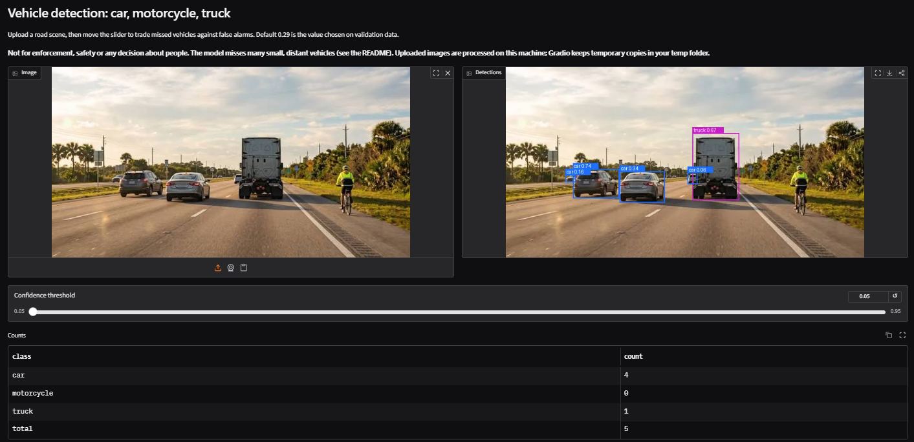
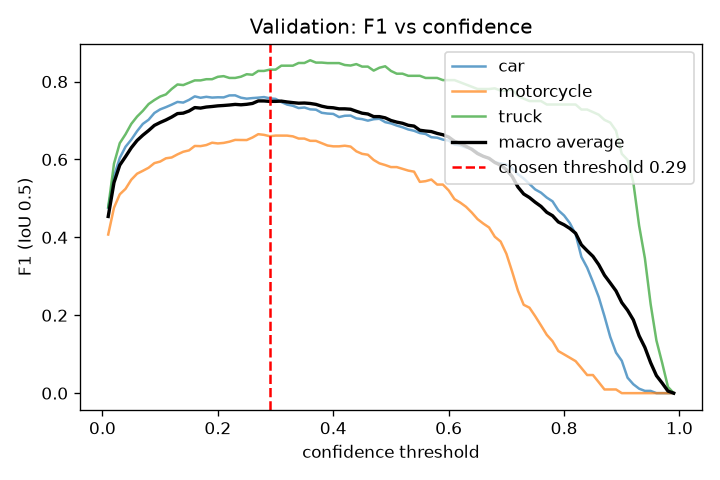
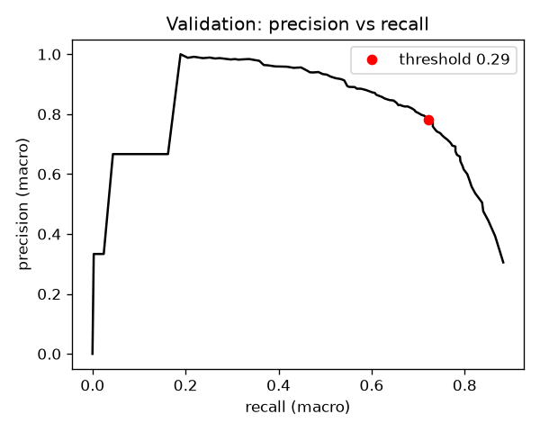
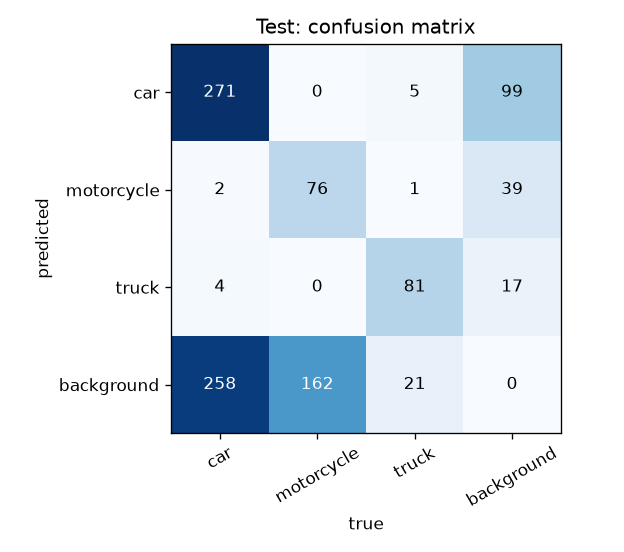

# Vehicle detection (car, motorcycle, truck) with YOLOv8

[](https://github.com/zohabaamir-ai/vehicle-detection-yolov8/actions/workflows/ci.yml)

A small, honest, reproducible object detector for traffic scenes: it finds **cars, motorcycles
and trucks** in an image. It is a rebuild of a university coursework project, redone with a
leakage-checked data split, a held-out test set that was scored exactly once, and confidence
intervals.

<!-- HEADLINE:START -->
**Held-out test split (126 images, 881 objects), scored once:** mAP@0.5 **0.598** (95% CI 0.543 to 0.670 by image, 0.520 to 0.835 by group) and mAP@0.5:0.95 **0.375** (95% CI 0.340 to 0.423 by image, 0.306 to 0.563 by group). At the confidence threshold 0.29, averaged over the three classes, precision is 0.72 and recall is 0.53.
<!-- HEADLINE:END -->

**In plain words:** the model is reliable for trucks and for larger, closer vehicles, but it
misses many small and distant ones, motorcycles most of all. It is a useful demo and a fair
baseline, not a vehicle counter you can trust in crowded scenes. Every number below is generated
from the files in [`results/`](results/), not typed by hand.

## Demo

<!-- DEMO:START -->


Sample images you can try: `samples/road_1.jpg`. Sources and licences: `samples/ATTRIBUTION.md`.
<!-- DEMO:END -->

Upload an image, move the confidence slider, and see the boxes, labels and a count per class.
It runs on a CPU. See [Quick start](#quick-start).

## Results

All figures and tables in this section are generated by `python -m vehicle_detection.report`.

<!-- RESULTS:START -->
### Main results

| metric | validation (135 images) | **test** (126 images) | test 95% CI, resampling images | test 95% CI, resampling groups |
|---|---|---|---|---|
| mAP@0.5 | 0.781 | 0.598 | 0.543 to 0.670 | 0.520 to 0.835 |
| mAP@0.5:0.95 | 0.463 | 0.375 | 0.340 to 0.423 | 0.306 to 0.563 |
| precision (macro) | 0.781 | 0.724 | 0.678 to 0.768 | 0.673 to 0.793 |
| recall (macro) | 0.723 | 0.528 | 0.471 to 0.602 | 0.449 to 0.788 |
| F1 (macro) | 0.749 | 0.601 | 0.551 to 0.656 | 0.537 to 0.781 |
| count error (vehicles per image) | 1.13 (true mean 5.0) | 3.06 (true mean 7.0) | n/a | n/a |

The confidence threshold (0.29) was chosen on validation data (best macro F1) and not changed afterwards. Intervals come from 1000 bootstrap resamples; resampling groups of near-identical images is the more honest of the two.

### Per class (test split)

| class | test objects | test AP@0.5 | 95% CI (images) | test AP@0.5:0.95 | precision | recall | validation AP@0.5 |
|---|---|---|---|---|---|---|---|
| car | 535 | 0.618 | 0.537 to 0.706 | 0.372 | 0.72 | 0.51 | 0.793 |
| motorcycle | 238 | 0.374 | 0.280 to 0.508 | 0.129 | 0.64 | 0.32 | 0.667 |
| truck | 108 | 0.802 | 0.723 to 0.882 | 0.623 | 0.80 | 0.76 | 0.883 |

### Images with no near-duplicate in the training set

| split | isolated images | all images (mAP@0.5 / 0.5:0.95) | isolated only | isolated only, 95% CI by group |
|---|---|---|---|---|
| validation | 75 of 135 | 0.781 / 0.463 | 0.757 / 0.438 | 0.705 to 0.839 / 0.385 to 0.597 |
| test | 58 of 126 | 0.598 / 0.375 | 0.639 / 0.401 | 0.558 to 0.823 / 0.316 to 0.575 |

### What is found, by object size

| object size (share of image area) | validation objects | found correctly | test objects | found correctly |
|---|---|---|---|---|
| tiny | 150 | 37% | 415 | 18% |
| small | 255 | 71% | 230 | 65% |
| medium | 180 | 87% | 128 | 81% |
| large | 95 | 93% | 108 | 91% |

### Counting (test split)

| class | true objects (test) | predicted at threshold | mean error per image |
|---|---|---|---|
| car | 535 | 375 | -1.27 |
| motorcycle | 238 | 118 | -0.95 |
| truck | 108 | 102 | -0.05 |

### Confusion matrix (test split, threshold 0.29)

|  | true car | true motorcycle | true truck | true background |
|---|---|---|---|---|
| predicted car | 271 | 0 | 5 | 99 |
| predicted motorcycle | 2 | 76 | 1 | 39 |
| predicted truck | 4 | 0 | 81 | 17 |
| predicted background | 258 | 162 | 21 | 0 |

### Data splits

| split | images | groups | boxes | car | motorcycle | truck | tiny boxes (share) | boxes per image | isolated images |
|---|---|---|---|---|---|---|---|---|---|
| train | 666 | 489 | 3167 | 1718 | 882 | 567 | 24% | 4.8 | - |
| val | 135 | 51 | 680 | 346 | 210 | 124 | 22% | 5.0 | 75 |
| test | 126 | 63 | 881 | 535 | 238 | 108 | 47% | 7.0 | 58 |

### All training runs (validation split)

| run | model | image size | seed | best epoch | val mAP@0.5 | val mAP@0.5:0.95 | mean of last 10 epochs (mAP@0.5:0.95) |
|---|---|---|---|---|---|---|---|
| `pilot_motorbike_name` | yolov8n.pt | 672 | 0 | 81 | 0.777 | 0.462 | 0.449 |
| `v11n_seed0` | yolo11n.pt | 672 | 0 | 81 | 0.793 | 0.474 | 0.469 |
| `v8n_imgsz960` | yolov8n.pt | 960 | 0 | 84 | 0.772 | 0.456 | 0.450 |
| `v8n_seed0` | yolov8n.pt | 672 | 0 | 53 | 0.796 | 0.476 | 0.461 |
| `v8n_seed1` | yolov8n.pt | 672 | 1 | 72 | 0.794 | 0.473 | 0.461 |
| `v8s_seed0` | yolov8s.pt | 672 | 0 | 54 | 0.797 | 0.477 | 0.466 |

The final model is the `best.pt` of run `v8n_seed0` (file `v8n_seed0_best.pt`, sha256 `cd50a260219d27fc3c1d1042f62f85a1770a24b9aefbbf0207dac9e858b031c0`).

Training environment of the final run: Ultralytics 8.4.174, PyTorch 2.11.0+cu130, Python 3.13.15, GPU Tesla T4.
<!-- RESULTS:END -->

### Figures

| F1 against confidence (validation) | Precision against recall (validation) | Confusion matrix (test) |
|---|---|---|
|  |  |  |

The confidence threshold was picked on the validation figure on the left. Moving it trades
missed vehicles against false alarms; the demo has a slider for exactly that.

## How to read these numbers

- **Validation vs test.** The validation split was used to choose the epoch and the confidence
  threshold, so its scores are mildly optimistic. The test split was scored **once**, for the
  final model only, by [`score_test.py`](src/vehicle_detection/score_test.py), which refuses to
  run a second time and only accepts the threshold chosen on validation.
- **Test is lower than validation.** The size table and the data table show why: the test split
  has far more tiny objects than the training split, and tiny objects are where the model is
  weakest. This is an explanation supported by those counts, not a proven decomposition.
- **Two intervals.** Resampling single images treats them as independent. They are not: many
  images are frames from the same fixed camera. Resampling whole groups of near-identical images
  is the more honest interval, and it is wide. With a test set this small, a gap of several
  points between two models is within the noise.
- **Isolated images.** Images with no near-duplicate in the training set give a more
  conservative view of how the model does on new scenes.
- **Same cameras everywhere.** Near-duplicates were removed across splits, but the data comes
  from a small number of fixed cameras, so every split still shows the same kinds of views. The
  numbers describe performance on **familiar camera types, not on new locations**.

### How this differs from the original coursework

The original coursework reported a mAP@0.5 of 0.803 (from its notebook log; the notebook and
report are not included here). That number is not comparable with the ones above: it came from a
model trained from scratch (no pretrained weights), measured on a 98-image split that was also
used during training to pick the epoch, and that split shared source images with the training
folder. Rebuilding the pipeline honestly gives a lower and more trustworthy number.

## Data

The dataset is **not included** and cannot be redistributed here.

- **Provenance and licence are unknown.** The files carry Roboflow-style names, so the data was
  probably exported from Roboflow, but the original source, annotators and licence could not be
  established. Many images appear to be web, video or television frames (some with logos or
  watermarks), and number plates are readable in some of them.
- **Classes:** `car`, `motorcycle` (the box includes the rider; no bicycles were seen) and
  `truck` (box trucks, dump trucks, tankers and lorries; vans and pickups are a grey area).
  Class names are the lower-case COCO names on purpose: Ultralytics then copies the pretrained
  detection-head rows for all three classes.
- **Label cleaning** ([`prepare.py`](src/vehicle_detection/prepare.py)): polygon labels were
  turned into boxes, boxes sticking out of the image were clipped, and files that mixed polygons
  with boxes were rewritten as plain boxes. (Some Ultralytics versions misread such mixed files.)
- **Leakage control** ([`dedup.py`](src/vehicle_detection/dedup.py),
  [`split.py`](src/vehicle_detection/split.py)): all images were pooled, grouped by exact source
  name and by a perceptual hash (distance 12 of 64, mirrored copies included), and whole groups
  were assigned to train, validation or test (70/15/15). Among 50 candidate seeds, the split with
  the most balanced image and class counts was kept; the choice used labels only, never model
  results. [`verify.py`](src/vehicle_detection/verify.py) checks a dataset folder against the
  committed manifest ([`results/split_manifest.csv`](results/split_manifest.csv)) by SHA-256.
- **Known weaknesses of the data:** a small number of fixed cameras; some augmented copies of the
  same source image; many tiny objects; a class (`truck`) with fuzzy edges; some three-wheelers
  that looked unlabeled and some buses that the model reported as trucks (in the images we
  inspected).

## Method

- **Model:** YOLOv8n initialised from COCO-pretrained weights, 100 epochs, image size 672,
  otherwise Ultralytics defaults. The pinned version is `ultralytics==8.4.174`. Trained `.pt`
  files are pickles tied to the library version, so use the same version to load them.
- **Choosing the final model, rules fixed before running:** a YOLOv8n baseline with two seeds to
  measure run-to-run noise; then two standard options (a bigger model, YOLOv8s, and a newer
  architecture, YOLO11n). An option is adopted only if its best-epoch validation mAP@0.5:0.95
  beats the baseline mean by more than the seed-to-seed spread. Neither option did. One extra,
  targeted experiment (a larger input size, chosen after looking at the validation failures,
  with a stricter margin of 0.01) also did not help. The simple model won.
- **Pilot run:** a first run named the motorcycle class `Motorbike`, which does not match COCO's
  `motorcycle`, so that class head started from scratch. The class was renamed and the run
  repeated. The pilot is listed in the runs table for transparency.
- **Threshold:** the confidence threshold that maximises the macro F1 on validation (IoU 0.5),
  after a small smoothing; NMS IoU is the default 0.7 and was not tuned.

## Quick start

```bash
git clone https://github.com/zohabaamir-ai/vehicle-detection-yolov8.git
cd vehicle-detection-yolov8
python -m venv .venv
.venv\Scripts\activate          # Windows; on Linux/macOS: source .venv/bin/activate
python -m pip install -e ".[dev,app]"
python -m pytest -q
```

Download the final weights from the project's
[Releases](https://github.com/zohabaamir-ai/vehicle-detection-yolov8/releases) page (the sha256
is in the results section above), then:

```bash
python -m vehicle_detection.demo --weights path/to/vehicle_detector_yolov8n.pt
```

Always run the code as `python -m vehicle_detection.<module>`: on some Windows machines the
launcher scripts that pip creates are blocked.

## Reproducing the pipeline

You need your own YOLO-format dataset (`train/`, `test/` folders with `images/` and `labels/`).

1. **Prepare** the clean, leakage-checked splits:
   `python -m vehicle_detection.prepare --root <raw dataset> --out <clean folder>`
2. **Train** on a Colab GPU with [`01_train_colab.ipynb`](notebooks/01_train_colab.ipynb).
3. **Export validation detections** with [`02_predict_colab.ipynb`](notebooks/02_predict_colab.ipynb)
   and score them: `python -m vehicle_detection.evaluate --choose-conf ...`
4. **Score the test split once** with
   [`03_predict_test_once_colab.ipynb`](notebooks/03_predict_test_once_colab.ipynb) and
   `python -m vehicle_detection.score_test ...` (try `--rehearsal` on validation first).
5. **Rebuild this README's tables and figures:**
   `python -m vehicle_detection.report --figures` and `python -m vehicle_detection.report --write`.
   CI runs `python -m pytest`, which fails if the README disagrees with `results/`.

The metrics code is plain NumPy and is checked against Ultralytics' own AP function on random
data. Our numbers come from the same single-label prediction path the demo uses, which is
slightly lower than the figure Ultralytics prints during validation (that uses multi-label NMS).

## Limitations

- **Dataset bias:** a few fixed cameras. In the images we inspected, the roads looked South-Asian or
  Southeast-Asian, mostly in daylight, with little weather variation (not every image was
  reviewed). Do not expect the numbers to carry over to other places.
- **Small objects:** distant vehicles and riders are often missed; the model under-counts in
  crowded scenes.
- **Class imbalance:** cars are the most frequent class, trucks the rarest. Per-class intervals
  are wide, especially for trucks and motorcycles.
- **Label quality:** boxes were not re-annotated; three-wheelers, buses and vans looked inconsistent in the images we inspected.
- **Small evaluation set:** the test split is small and made of correlated images, so intervals
  are wide.
- **Privacy:** the training images show number plates and people. The model does not read plates
  or recognise people, but you should not run it on images you have no right to process.
- **Not for enforcement or safety use.** Do not use it to fine, track, or make decisions about
  people or vehicles.

## Licence

This repository is licensed under the **GNU Affero General Public License v3.0** (see
[`LICENSE`](LICENSE)). The reason: it depends on [Ultralytics YOLO](https://github.com/ultralytics/ultralytics),
which is AGPL-3.0, and weights trained with it are generally treated the same way. In practice:
if you modify this code or the weights and let others use them over a network, you must offer
them the source under the same licence. Closed-source use needs a separate commercial licence
from Ultralytics. This is a summary, not legal advice.

The licence covers the code and the trained weights only. The training images and labels are
**not** covered by it and are not included.

## Credits

- Author: Zohab Aamir (BS Artificial Intelligence, UMT Lahore).
- [Ultralytics](https://github.com/ultralytics/ultralytics) for YOLOv8 and the COCO-pretrained
  starting weights.
- The anonymous creators and annotators of the original dataset (source unknown).
- An earlier coursework version of this project (2025) used the same data; its report is not
  included.
